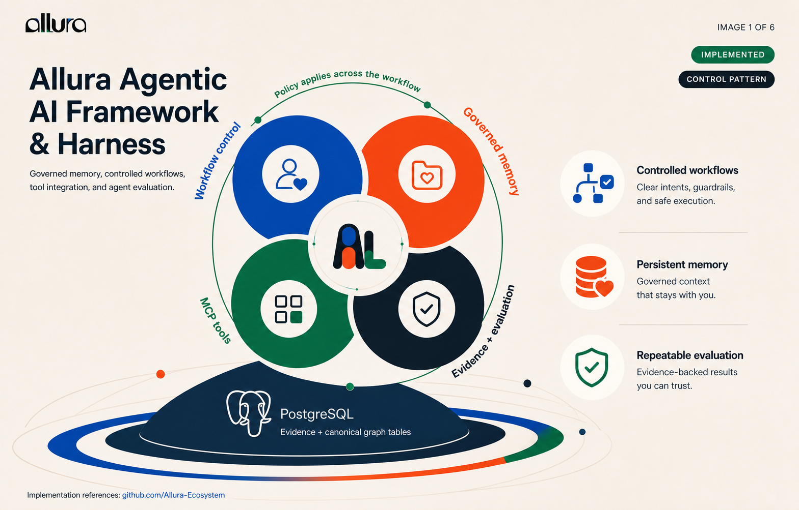
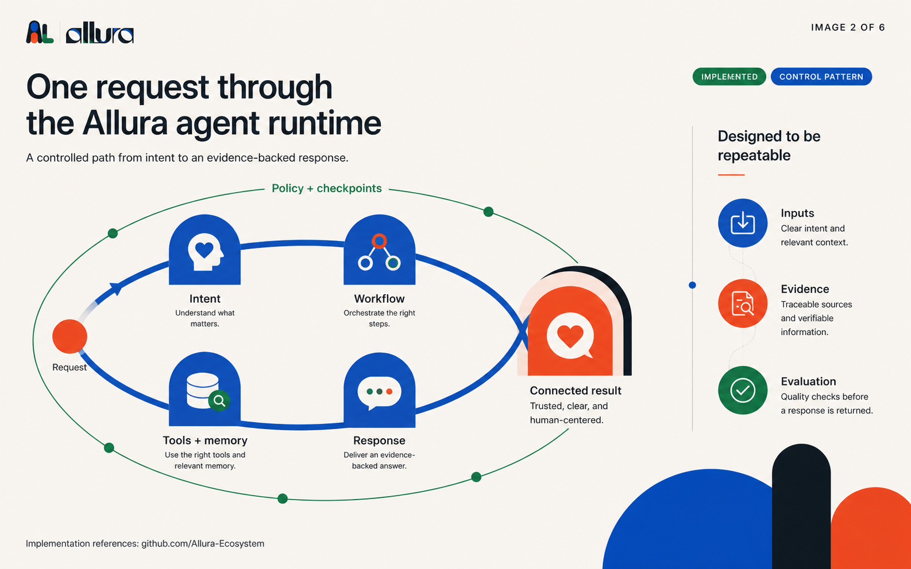
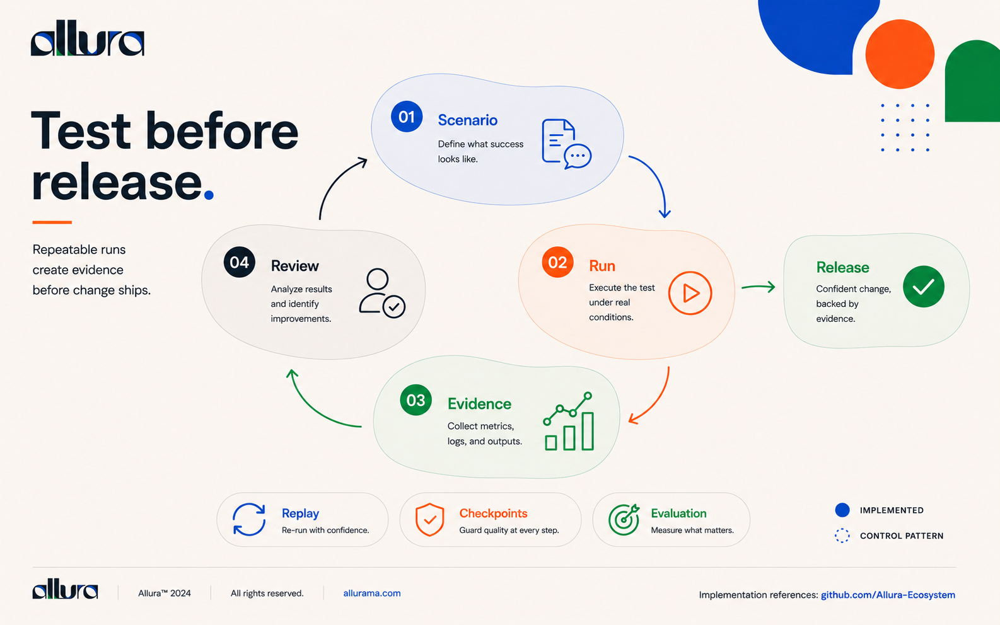
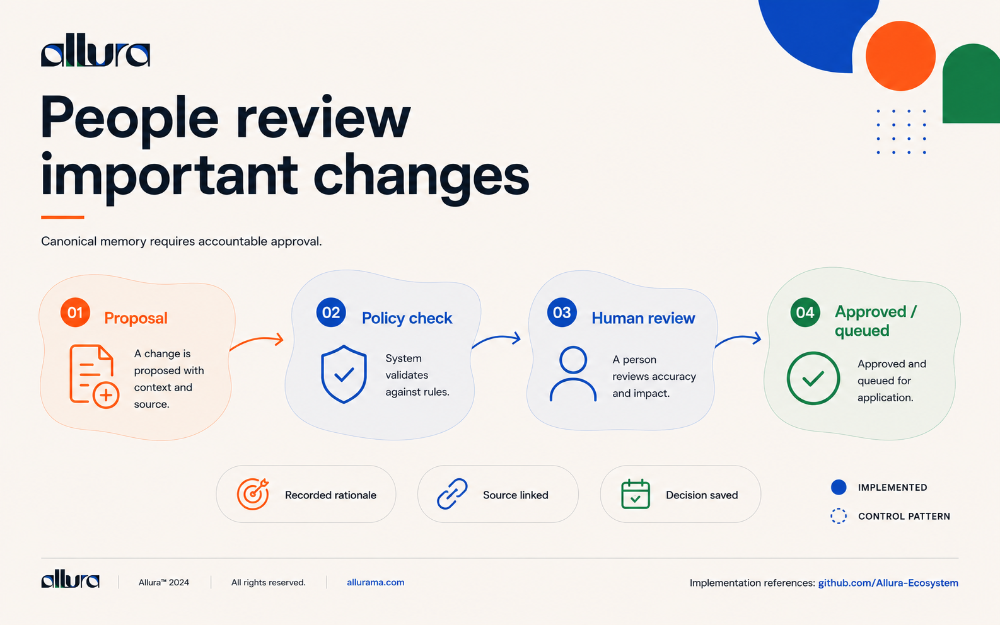
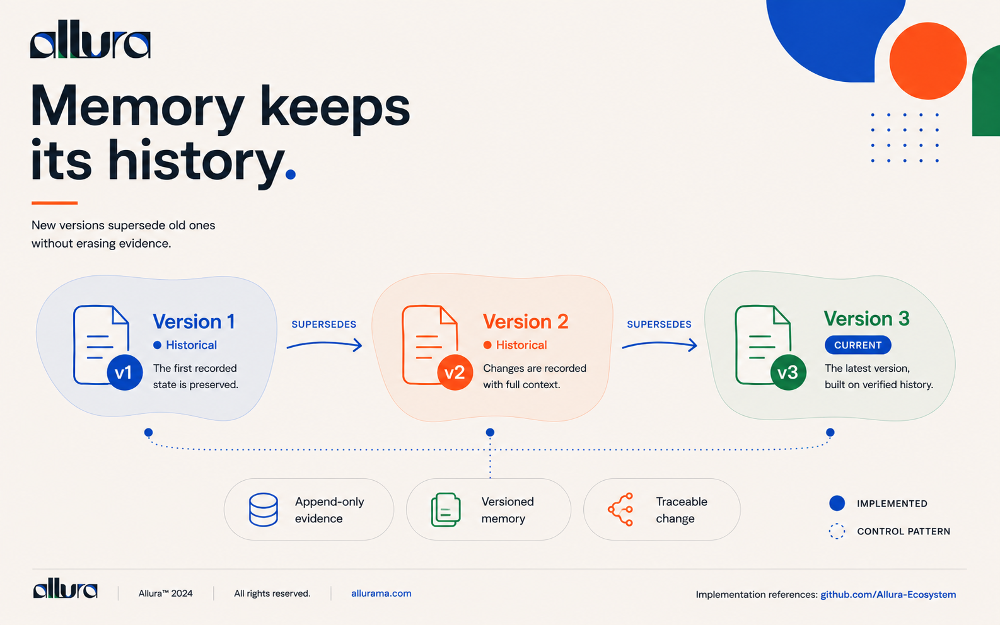
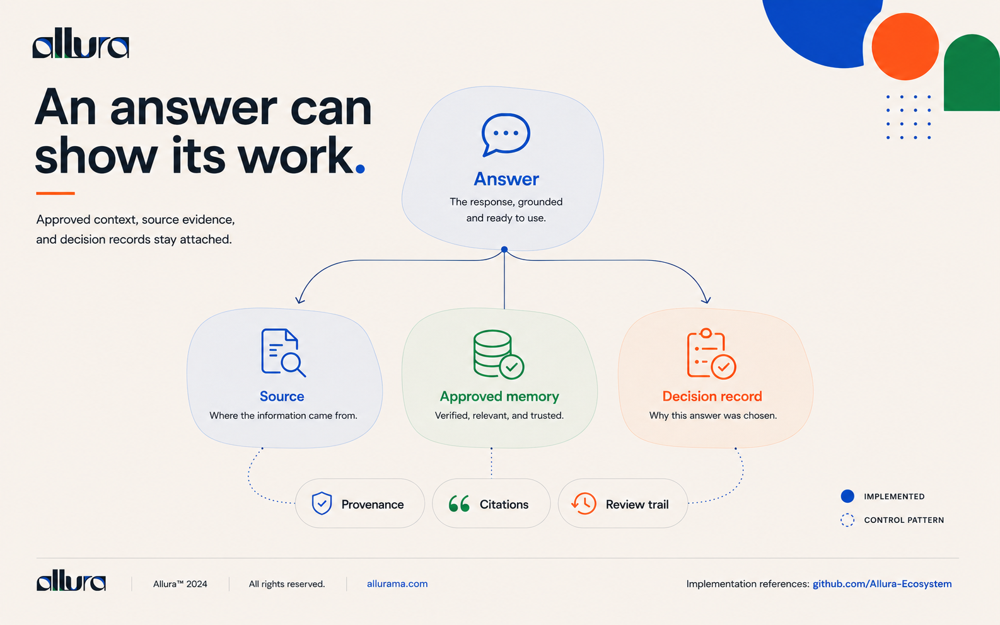

# Team Durham

Team Durham is a portable, governed multi-agent system for turning a client brief into brand strategy, naming, visual direction, a production-ready brand kit, and evidence-backed QA.

This repository is the **canonical public source** for Team Durham. Catalog copies are generated exports; they are not edited independently.

---

## How Team Durham operates

### 1. One framework, five pillars

<p align="center">
  <a href="docs/images/framework-and-harness.png"></a>
</p>

Team Durham is built on **strategy foundation** (Kotler and Aaker lock the truth), **specialist production** (Ogilvy, Glaser, and Rand craft the system), **independent QA** (Munari verifies consistency), **evidence collection** (Reality Checker and Evidence Collector prove claims), and **governance gates** (authority and safety constraints shape decisions).

---

### 2. Every request follows a controlled path

<p align="center">
  <a href="docs/images/agent-runtime-request-flow.png"></a>
</p>

**Brief** → **Scout discovers context** → **Kotler and Aaker lock strategy** → **Ogilvy, Glaser, Rand produce** → **QA and reality-check** → **Evidence collected** → **Delivered with proof**. Every step is documented and reversible.

---

### 3. Validation before every release

<p align="center">
  <a href="docs/images/test-before-release.png"></a>
</p>

No brand ships without proof. The system runs declared QA checks, collects evidence (screenshots, artifacts, measurements), and blocks release if validation fails. You decide what constitutes brand-ready; the system enforces it.

---

### 4. Humans approve before truth is written

<p align="center">
  <a href="docs/images/people-review-important-changes.png"></a>
</p>

Brand decisions require human review. **Proposal** → **policy check** → **human decision** → **approved or queued**. This is not optional; it protects the brand and your authority.

---

### 5. Everything stays traceable forever

<p align="center">
  <a href="docs/images/memory-keeps-its-history.png"></a>
</p>

Brand decisions are versioned, not overwritten. Version 1 is preserved. Version 2 records what changed and why. Version 3 is current but built on verified history. Audit trails and immutable versioning mean every creative decision is auditable.

---

### 6. An answer can show its work

<p align="center">
  <a href="docs/images/an-answer-can-show-its-work.png"></a>
</p>

Every deliverable carries **rationale** (why this direction), **source strategy** (which brand truth it expresses), and a **review trail** (who approved it and when). Transparency builds stakeholder confidence.

---

## What is included

- **12 canonical roles** for strategy, creative production, QA, evidence, workflow, and trust
- **1 compatibility fallback definition** (`openagent`) for runtimes that require a generic catch-all
- **77 skills** and **22 commands**
- Contracts, governance rules, prompt evaluations, Claude/Codex manifests, and a BMAD adapter
- A deterministic catalog export contract with source-revision provenance

> **Why 13 files but 12 roles?** `agents/` contains 13 loadable definitions. Twelve represent Team Durham's canonical role model. `openagent.md` is a runtime compatibility fallback with no persona and is deliberately not counted as a canonical role. See [Architecture](ARCHITECTURE.md#role-model-12--1).

## Canonical roles

| Definition | Persona | Responsibility |
| --- | --- | --- |
| `brand-orchestrator` | Philip Kotler | Pipeline routing and STP gate |
| `brand-strategist` | Jennifer Aaker | Positioning, personality, and brand truth |
| `copywriter` | David Ogilvy | Naming, voice, and copy |
| `visual-director` | Milton Glaser | Visual direction and logo systems |
| `brand-kit-builder` | Paul Rand | Brand kit and design-system assembly |
| `qa-reviewer` | Bruno Munari | Read-only consistency and readiness QA |
| `data-analyst` | Edward Tufte | Research and evidence-based analysis |
| `scout-recon` | Utility role | Fast, read-only discovery |
| `reality-checker` | Operations role | Proof-based completion gate |
| `evidence-collector` | Operations role | Screenshots and artifact evidence |
| `workflow-architect` | Operations role | Handoffs, states, and recovery paths |
| `agentic-trust-architect` | Operations role | Identity, authorization, audit, and provenance |

## Operating model

1. **Discover before changing** — Scout locates authoritative context and risks.
2. **Strategy before pixels** — Kotler and Aaker lock audience, positioning, and brand truth first.
3. **Specialists produce** — Ogilvy, Glaser, and Rand create the system and deliverables.
4. **QA stays independent** — Munari reports findings; producing roles perform fixes.
5. **Claims require evidence** — Reality Checker and Evidence Collector verify the actual artifact.
6. **Governance wins over persona** — project/client authority and safety constraints outrank stylistic simulation.

## Install

Clone the canonical repository:

```bash
git clone https://github.com/Allura-Ecosystem/team-durham.git
cd team-durham
python3 scripts/validate_repository.py
```

For Claude Code development, load the checkout as a local plugin:

```bash
claude --plugin-dir "$PWD"
```

The generated `allura-plugins` catalog package remains the consumer-friendly marketplace route after catalog integration. It must identify the exact standalone commit from which it was exported. See [Installation](docs/INSTALLATION.md) and [Catalog export](docs/CATALOG-EXPORT.md).

## Configure

Team Durham works without external services for file-based strategy and production guidance. Integrations are opt-in:

| Capability | Configuration | When unavailable |
| --- | --- | --- |
| Allura Memory / Brain | MCP server plus scoped `group_id` | No durable recall/write; workflow must report degraded state |
| Figma | Runtime MCP configuration; token supplied outside the repo | Figma-specific skills stop or offer a file-based path |
| fal.ai | `FAL_KEY` in the caller's secret store | Image-generation steps stop; no synthetic success evidence |
| Notion | `NOTION_TOKEN` in the caller's secret store | Publishing steps are skipped and reported |
| Docker MCP toolkit | Docker and configured MCP gateway | Docker-backed tools remain unavailable |
| LibreOffice MCP | `MCP_LIBRE_ROOT` and `fastmcp` | Office automation remains unavailable |

Never commit credentials. Full details: [Configuration](docs/CONFIGURATION.md) and [Degraded behavior](docs/DEGRADED-BEHAVIOR.md).

## Repository map

```text
agents/             canonical role definitions (+ openagent compatibility fallback)
commands/           canonical user-facing workflows
skills/             canonical reusable procedures
contracts/          machine-readable handoff contracts
governance/         authority and policy notes
rules/              runtime guidance
evals/              canonical prompt-evaluation snapshots and policy
bmad-module/         generated/runtime adapter source
.claude-plugin/      Claude manifest
.codex-plugin/       Codex manifest
scripts/             validation and catalog export
clients/             preserved historical/client workspace data; not exported
.opencode/           preserved legacy Team RAM/OpenCode compatibility surface; not canonical
```

## Ecosystem boundaries

- **Team Durham** owns this brand-production role/command/skill source.
- **Allura Memory** is an optional governed memory dependency, not bundled here.
- **Team RAM** is a separate engineering-delivery harness. The preserved `.opencode/` surface in this repository is compatibility history, not Team Durham authority.
- **allura-plugins** is a distribution catalog. Its Team Durham directory must be generated from a pinned commit of this repository.

See [Architecture](ARCHITECTURE.md) for authority and dependency boundaries.

## Validate and export

```bash
npm test
npm run export:check
npm run export -- --output /tmp/team-durham-export
```

The exporter injects the source Git SHA and a SHA-256 file inventory into the generated package. CI verifies manifests, role counts, paths, JSON contracts, evaluations, and export reproducibility.

## Security and contributing

Read [SECURITY.md](SECURITY.md) before reporting vulnerabilities and [CONTRIBUTING.md](CONTRIBUTING.md) before changing canonical surfaces.

## License

MIT — see [LICENSE](LICENSE).
